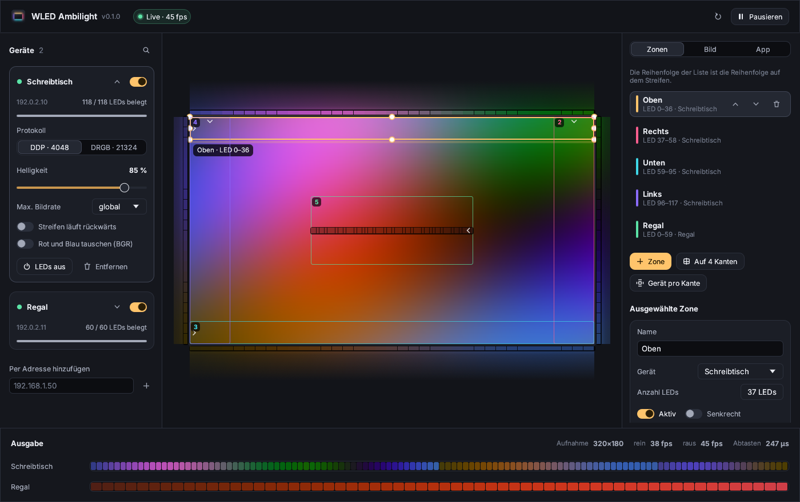

# WLED Ambilight

[](https://github.com/Smotherer007/wledambilight/actions/workflows/ci.yml)
[](https://github.com/Smotherer007/wledambilight/releases/latest)
[](LICENSE)

**English:** [README.md](README.md)

Ein leichtgewichtiges Ambilight für [WLED](https://kno.wled.ge/). Das Programm
nimmt den Bildschirm auf, mittelt frei platzierbare Zonen und schickt die
Farben in Echtzeit an ein oder mehrere WLED-Geräte – das Licht hinter Monitor
oder Fernseher folgt dem Bild. Läuft unter **Linux, Windows und macOS**.



## Funktionen

- **Findet Geräte selbst** – per mDNS und Suche im eigenen Subnetz; LED-Anzahl,
  Name und Firmware kommen aus WLEDs `/json/info`. Geräte in anderen Netzen
  lassen sich per IP oder Hostname hinzufügen.
- **Zonen statt fester Layouts** – eine Zone ist ein beliebiges Rechteck auf
  dem Bildschirm, das einen Abschnitt eines Streifens steuert. Mit der Maus
  verschieben und skalieren, Einrasten an Kanten und anderen Zonen,
  Feinjustierung mit den Pfeiltasten. Alle Koordinaten sind normalisiert –
  Auflösung, Skalierung und Moduswechsel spielen keine Rolle.
- **Ein Streifen rund um den Bildschirm oder ein Gerät pro Kante** – „Auf 4
  Kanten“ verteilt einen Streifen nach Kantenlänge auf oben/rechts/unten/links;
  „Gerät pro Kante“ legt bis zu vier einzelne WLED-Controller auf je eine Kante.
- **Beliebig viele LEDs** über DDP (UDP 4048, 480 LEDs pro Paket, das Bild
  erscheint auf einen Schlag); DRGB (UDP 21324) für alte Firmware bis 490 LEDs.
- **Ruhiges, flimmerfreies Licht** – Median über drei Bilder, exponentielle
  zeitliche Glättung, räumliche Glättung entlang des Streifens und eine
  Begrenzung, wie schnell sich eine LED ändern darf.
- **Farbregler** – Helligkeit (global und pro Gerät), Gamma, Sättigung,
  Verstärkung pro Zone, rückwärts laufende Streifen und BGR-Klone.
- **Bildrate** 24–144 fps global, dazu eine Obergrenze pro Gerät.
- **Live-Ansicht** – die Vorschau zeigt das Licht, das jede Zone an die Wand
  wirft, ein Lineal mit der Farbe jeder LED und die genaue Ausgabe pro Gerät.
- **Hintergrundbetrieb** – Tray-/Menüleisten-Symbol, Schließen ins Tray,
  `--minimized` für den Autostart, `--headless` für Systeme ohne Desktop.
- **Deutsche und englische** Oberfläche, richtet sich nach der Systemsprache.

## Installation

Das passende Paket gibt es beim
[neuesten Release](https://github.com/Smotherer007/wledambilight/releases/latest).

| System | Datei | Hinweis |
| --- | --- | --- |
| Linux (jede Distribution) | `wled-ambilight-*.flatpak` | `flatpak install --user wled-ambilight-*.flatpak` – empfohlen für Fedora Atomic / Bazzite / SteamOS |
| Debian, Ubuntu, Mint | `wled-ambilight_*_amd64.deb` | `sudo apt install ./wled-ambilight_*.deb` |
| Fedora, openSUSE | `wled-ambilight-*.x86_64.rpm` | `sudo dnf install ./wled-ambilight-*.rpm` |
| Linux, portabel | `wled-ambilight-*-linux-x86_64.tar.gz` | Programm plus Desktop-Datei und Icons |
| Windows 10 1903+ / 11 | `…-windows-x86_64-setup.exe` | Installer mit optionalem Autostart; oder das portable `.zip` |
| macOS 13+ (Apple Silicon und Intel) | `…-macos-universal.dmg` | in *Programme* ziehen |

### Erster Start je System

**Linux** – der Desktop fragt einmal, welcher Monitor geteilt werden soll
(xdg-desktop-portal). Die Freigabe wird gespeichert, spätere Starts kommen ohne
Dialog aus. Ohne Flatpak wird GStreamer mit PipeWire-Plugin benötigt
(`gstreamer1.0-pipewire` unter Debian/Ubuntu, `pipewire-gstreamer` unter Fedora –
die `.deb`/`.rpm` ziehen das automatisch nach).

**Windows** – nichts zu bestätigen. Das eigene Fenster wird aus der Aufnahme
ausgeblendet (ab Windows 10 2004), die Vorschau landet also nie in den LEDs.
Windows 10 zeichnet einen gelben Rahmen um den aufgenommenen Bildschirm;
unter Windows 11 schaltet die App ihn ab.

**macOS** – macOS fragt nach der Berechtigung *Bildschirm- & Systemaudioaufnahme*.
In *Systemeinstellungen → Datenschutz & Sicherheit* erlauben und die App neu
starten. Ist der Build nicht notarisiert, meldet macOS, die App „kann nicht
überprüft werden“: einmal per Rechtsklick → *Öffnen* starten, oder
`xattr -dr com.apple.quarantine "/Applications/WLED Ambilight.app"` ausführen.

## Schnellstart

1. **WLED vorbereiten.** Jede aktuelle WLED-Version funktioniert direkt:
   Echtzeit-UDP ist standardmäßig an (*Config → Sync Interfaces → Realtime*).
   LED-Anzahl und Stromlimit (ABL) wie gewohnt dort einstellen.
2. **WLED Ambilight starten.** Das Netzwerk wird automatisch durchsucht; beim
   Gerät auf **+** klicken. Es bekommt eine Zone mit allen LEDs an einer freien
   Bildschirmkante.
3. **Zonen platzieren.** Für einen Streifen rund um den Bildschirm die Zone
   auswählen und **Auf 4 Kanten** klicken. Richtung prüfen: der kleine Pfeil in
   jeder Zone markiert LED 0. Läuft das Licht falsch herum, beim Gerät
   **Streifen läuft rückwärts** einschalten.
4. **Bild abstimmen** im Reiter *Bild*. Alles wird automatisch gespeichert.

## Begriffe

- **Gerät** – ein WLED-Controller mit *n* LEDs.
- **Zone** – ein Rechteck auf dem Bildschirm plus eine Anzahl LEDs. Jede Zone
  belegt die nächsten freien LEDs ihres Geräts; **die Reihenfolge der
  Zonenliste ist die Reihenfolge auf dem Streifen** (`LED 0–36`, `LED 37–58`, …).
  Die LED-Anzahl ist unabhängig von der Größe: das Rechteck wird in gleiche
  Zellen geteilt, eine pro LED, und jede Zelle gemittelt.
- **Waagerecht / senkrecht** – waagerechte Zonen laufen links → rechts,
  senkrechte oben → unten. Ist ein Streifen andersherum verkabelt, wird das pro
  Gerät mit **Streifen läuft rückwärts** korrigiert (spiegelt den ganzen
  Streifen inklusive der Reihenfolge aufgeteilter Zonen).
- **Aufnahmeauflösung** – der Bildschirm wird auf einen kleinen Puffer
  verkleinert (Standard 320 px breit). Das ist die Genauigkeit der Zonen; höhere
  Werte erlauben feinere Zonen und kosten etwas mehr CPU.

## Bedienung

| Aktion | So geht's |
| --- | --- |
| Zone verschieben / skalieren | Zone oder ihre Kanten und Ecken ziehen (rastet an Bildschirmkanten, Mitte und anderen Zonen ein; abschaltbar im Reiter *App*) |
| Ausgewählte Zone fein verschieben | Pfeiltasten, mit <kbd>Shift</kbd> in großen Schritten |
| Ausgewählte Zone löschen | <kbd>Entf</kbd> |
| Auswahl aufheben | <kbd>Esc</kbd> |
| Pausieren / fortsetzen | Knopf in der Titelleiste oder Tray-Menü (die LEDs behalten ihre Farbe) |
| Ins Tray legen | Fenster schließen; beenden über das Tray-Menü |

### Bildeinstellungen

| Einstellung | Wirkung | Standard |
| --- | --- | --- |
| Helligkeit | globaler Faktor, multipliziert mit der Helligkeit pro Gerät | 100 % |
| Sättigung | 0 % = grau, 200 % = kräftig | 100 % |
| Gamma | > 1 dunkelt dunkle Töne ab (mehr Kontrast), < 1 hellt sie auf | 1,00 |
| Zeitliche Glättung | Zeitkonstante der Überblendung; 0 = aus (schaltet auch den Median ab) | 180 ms |
| Räumliche Glättung | mischt jede LED mit ihren Nachbarn | 60 % |
| Max. Änderung pro Sekunde | begrenzt, wie schnell sich eine LED ändert (Skala 0–255) | 900 |
| Bildrate | wie oft die LEDs aktualisiert werden; Obergrenzen pro Gerät in der Gerätekarte | 50 fps |

### Kommandozeile

```text
wled-ambilight [Optionen]
  --minimized        minimiert starten (Autostart mit Tray)
  --headless         ohne Fenster laufen (Server, kein Tray)
  --config <Datei>   diese Konfigurationsdatei statt der Standarddatei
  -V, --version      Version ausgeben
  -h, --help         Hilfe ausgeben
```

Umgebungsvariablen: `AMBILIGHT_STATS=1` gibt alle zwei Sekunden Zeit- und
Flimmerstatistiken aus; `AMBILIGHT_DEMO=1` ersetzt den Bildschirm durch ein
animiertes Testbild (keine Aufnahmeberechtigung nötig – praktisch zum
Ausprobieren eines Streifens).

### Autostart

- **Windows** – im Installer *Automatisch starten* ankreuzen, oder eine
  Verknüpfung zu `wled-ambilight.exe --minimized` in `shell:startup` legen.
- **macOS** – *Systemeinstellungen → Allgemein → Anmeldeobjekte → +* und die App wählen.
- **Linux** – Desktop-Datei kopieren und den Schalter ergänzen:

  ```sh
  mkdir -p ~/.config/autostart
  sed 's/^Exec=wled-ambilight$/Exec=wled-ambilight --minimized/' \
    /usr/share/applications/io.github.smotherer007.WledAmbilight.desktop \
    > ~/.config/autostart/wled-ambilight.desktop
  ```

  (Flatpak: `Exec=flatpak run io.github.smotherer007.WledAmbilight --minimized`.)

## Konfiguration

Alles wird automatisch als JSON gespeichert:

| System | Pfad |
| --- | --- |
| Linux | `~/.config/wled-ambilight/config.json` (`$XDG_CONFIG_HOME`) |
| Flatpak | `~/.var/app/io.github.smotherer007.WledAmbilight/config/wled-ambilight/config.json` |
| Windows | `%APPDATA%\wled-ambilight\config.json` |
| macOS | `~/Library/Application Support/wled-ambilight/config.json` |

Alle Zonenkoordinaten sind normalisiert (0…1) relativ zum aufgenommenen
Bildschirm, die Datei lässt sich also zwischen Rechnern kopieren. Sie wird
atomar geschrieben (kein halb geschriebener Zustand bei Absturz).

## Funktionsweise

```text
 Bildschirm ──► Aufnahme ──► kleines RGB-Bild (z. B. 320×180)
                Linux:   Portal + PipeWire (GStreamer)
                Windows: Windows Graphics Capture
                macOS:   ScreenCaptureKit
                                 │
                                 ▼
                  Zonen → eine Zelle pro LED → Mittelwert
                                 │
           Median aus 3 Bildern → exponentielle Glättung → Ratenbegrenzung
                                 │
              Gamma, Sättigung, Helligkeit, BGR, Rückwärts
                                 │
                                 ▼
                 DDP / DRGB über UDP ──► WLED-Geräte
```

Die Pipeline läuft in einem eigenen Thread auf einem festen Takt, der ein
Vielfaches der Zielrate ist – so greifen die Obergrenzen pro Gerät exakt und
die Oberfläche kann die LEDs nie ausbremsen. Neue Bilder werden einmal
abgetastet; Takte dazwischen führen nur die Glättung weiter, Übergänge bleiben
dadurch flüssig.

Unter Linux friert das Fenster seine Vorschau ein, solange es nicht aktiv ist,
weil das Portal das eigene Fenster nicht aus der Aufnahme herausnehmen kann;
unter Windows und macOS wird das Fenster stattdessen aus der Aufnahme
ausgeblendet.

## Fehlerbehebung

| Problem | Lösung |
| --- | --- |
| Kein Gerät gefunden | Gleiches Netz/VLAN? Firewalls müssen ausgehendes UDP und mDNS erlauben. Gerät per IP hinzufügen. |
| LEDs flackern | *Zeitliche Glättung* erhöhen oder *Max. Änderung pro Sekunde* senken; Netzteil und ABL-Limit in WLED prüfen. |
| Farben laufen falsch herum | *Streifen läuft rückwärts* in der Gerätekarte. |
| Rot und Blau vertauscht | *Rot und Blau tauschen (BGR)*, oder die Farbreihenfolge in WLEDs LED-Einstellungen setzen. |
| WLED zeigt wieder den eigenen Effekt | Die App sendet dauerhaft, auch pausiert; prüfen, ob in WLED *Realtime* aktiv und das Gerät hier eingeschaltet ist. |
| Linux: „gst-launch-1.0 nicht gefunden“ | GStreamer und PipeWire-Plugin installieren (siehe *Installation*) oder das Flatpak nutzen. |
| Linux: falscher Monitor | *App → Anderen Monitor wählen* fragt das Portal erneut. |
| macOS: schwarze Vorschau / Fehler | Berechtigung *Bildschirmaufnahme* erteilen und App neu starten (macOS-Regel). Nach einem Update braucht ein unsignierter Build die Berechtigung eventuell erneut. |

## Selbst bauen

Voraussetzung: [Rust](https://rustup.rs/) 1.90 oder neuer.

- **Linux:** zur Laufzeit `gst-launch-1.0` mit `pipewiresrc` und ein laufendes
  xdg-desktop-portal. Keine zusätzlichen Build-Abhängigkeiten.
- **Windows:** die MSVC-Toolchain (Visual Studio Build Tools).
- **macOS:** Xcode oder die Command Line Tools (SDK 13.0 oder neuer).

```sh
git clone https://github.com/Smotherer007/wledambilight.git
cd wledambilight
cargo run --release
cargo test
```

Die Pakete (Flatpak, `.deb`, `.rpm`, Installer, `.dmg`) baut GitHub Actions;
den Release-Ablauf beschreibt [CONTRIBUTING.md](CONTRIBUTING.md), Flatpak und
Flathub [packaging/flatpak/README.md](packaging/flatpak/README.md).

## Lizenz

Copyright © 2026 Patrick Weppelmann.

WLED Ambilight ist freie Software: Sie darf unter den Bedingungen der
**GNU General Public License, Version 3**, wie von der Free Software Foundation
veröffentlicht, weitergegeben und verändert werden. Sie wird in der Hoffnung
verbreitet, dass sie nützlich ist, aber OHNE JEDE GEWÄHRLEISTUNG. Der
vollständige Text steht in [LICENSE](LICENSE). Wer eine veränderte Version
weitergibt, muss deren Quellcode unter derselben Lizenz veröffentlichen.

Die mitgelieferte Schrift [Inter](https://rsms.me/inter/) steht unter der SIL
Open Font License 1.1 ([assets/fonts/OFL.txt](assets/fonts/OFL.txt)).
WLED ist ein Projekt von Aircoookie und Mitwirkenden und steht in keiner
Verbindung zu dieser App.
