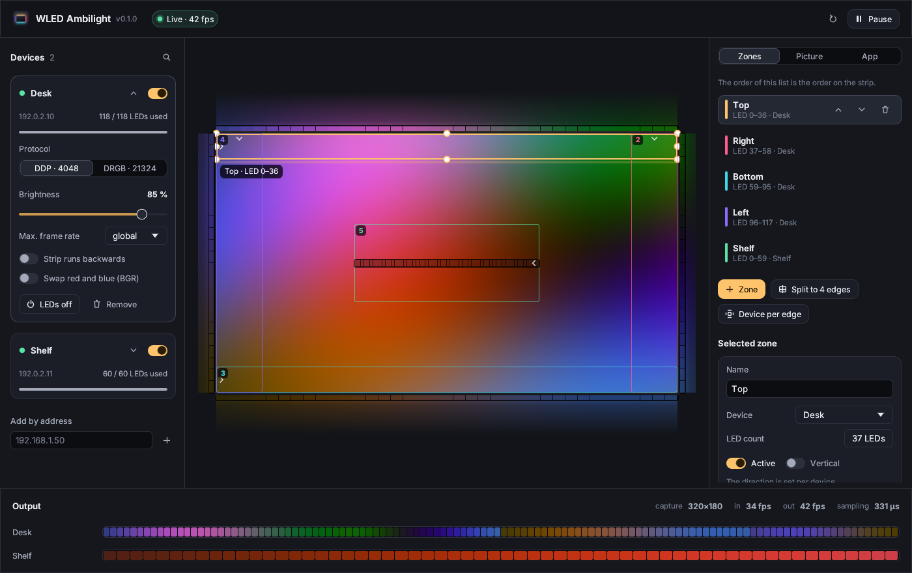

# WLED Ambilight

[](https://github.com/Smotherer007/wledambilight/actions/workflows/ci.yml)
[](https://github.com/Smotherer007/wledambilight/releases/latest)
[](LICENSE)

**Deutsch:** [README.de.md](README.de.md)

A lightweight ambilight for [WLED](https://kno.wled.ge/). It captures your
screen, averages freely placed zones and streams the colours to one or more
WLED devices in real time – the light behind your monitor or TV follows the
picture. Runs on **Linux, Windows and macOS**.



## Features

- **Finds your devices by itself** – mDNS plus a sweep of the local subnet;
  LED count, name and firmware come from WLED's `/json/info`. Devices on
  other subnets can be added by IP or host name.
- **Zones instead of fixed layouts** – a zone is any rectangle on the screen
  that drives a section of a strip. Drag and resize with the mouse, snap to
  edges and other zones, nudge with the arrow keys. Coordinates are
  normalised, so resolution, scaling and mode switches don't matter.
- **One strip around the screen or one device per edge** – “Split to 4
  edges” shares a strip over top/right/bottom/left by edge length; “Device per
  edge” puts up to four separate WLED boards on their own edge.
- **Any number of LEDs** via DDP (UDP 4048, 480 LEDs per packet, the frame is
  shown at once); DRGB (UDP 21324) for old firmware up to 490 LEDs.
- **Calm, flicker-free light** – median filter over three frames, exponential
  temporal smoothing, spatial smoothing along the strip and a limit on how
  fast an LED may change.
- **Colour controls** – brightness (global and per device), gamma, saturation,
  per-zone gain, reversed strips and BGR clones.
- **Frame rate** 24–144 fps globally, plus a cap per device.
- **Live view** – the preview shows the light each zone throws onto the wall,
  a ruler with the colour of every LED, and the exact output per device.
- **Background operation** – tray / menu bar icon, close-to-tray,
  `--minimized` for autostart, `--headless` for setups without a desktop.
- **German and English** interface, following the system language.

## Install

Download the package for your system from the
[latest release](https://github.com/Smotherer007/wledambilight/releases/latest).

| System | File | Notes |
| --- | --- | --- |
| Linux (any distro) | `wled-ambilight-*.flatpak` | `flatpak install --user wled-ambilight-*.flatpak` – recommended for Fedora Atomic / Bazzite / SteamOS |
| Debian, Ubuntu, Mint | `wled-ambilight_*_amd64.deb` | `sudo apt install ./wled-ambilight_*.deb` |
| Fedora, openSUSE | `wled-ambilight-*.x86_64.rpm` | `sudo dnf install ./wled-ambilight-*.rpm` |
| Linux, portable | `wled-ambilight-*-linux-x86_64.tar.gz` | binary plus desktop file and icons |
| Windows 10 1903+ / 11 | `…-windows-x86_64-setup.exe` | installer, optional autostart; or the portable `.zip` |
| macOS 13+ (Apple silicon and Intel) | `…-macos-universal.dmg` | drag to *Applications* |

### First start per system

**Linux** – the desktop asks once which monitor to share (xdg-desktop-portal).
The permission is remembered, later starts need no dialog. The non-Flatpak
packages need GStreamer with the PipeWire plugin (`gstreamer1.0-pipewire` on
Debian/Ubuntu, `pipewire-gstreamer` on Fedora – the `.deb`/`.rpm` pull them in).

**Windows** – nothing to confirm. The app hides its own window from the
capture (Windows 10 2004 and newer), so the preview never ends up in your
LEDs. Windows 10 draws a yellow frame around a captured screen; Windows 11
lets the app switch it off.

**macOS** – macOS asks for *Screen & System Audio Recording* permission. Allow
it in *System Settings → Privacy & Security* and restart the app. If the build
is not notarised, macOS says the app “cannot be checked”: right-click the app
→ *Open* once, or run `xattr -dr com.apple.quarantine "/Applications/WLED Ambilight.app"`.

## Quick start

1. **Prepare WLED.** Any recent WLED works out of the box: realtime UDP is
   on by default (*Config → Sync Interfaces → Realtime*). Set the LED count and
   the power limit (ABL) there as usual.
2. **Start WLED Ambilight.** The network is searched automatically; click
   **+** next to a device. It gets one zone with all its LEDs on a free
   screen edge.
3. **Place the zones.** For a strip running around the screen select its
   zone and click **Split to 4 edges**. Check the direction: the small chevron
   in each zone marks LED 0. If the light runs the wrong way, switch on
   **Strip runs backwards** for the device.
4. **Tune the picture** on the *Picture* tab. Settings are saved automatically.

## Concepts

- **Device** – one WLED controller with *n* LEDs.
- **Zone** – a rectangle on the screen plus a number of LEDs. Each zone
  takes the next free LEDs of its device; **the order of the zone list is
  the order on the strip** (`LED 0–36`, `LED 37–58`, …). The LED count of a
  zone is independent of its size: the rectangle is cut into equal cells, one
  per LED, and each cell is averaged.
- **Horizontal / vertical** – horizontal zones run left → right, vertical
  zones top → bottom. A strip that is wired the other way round is fixed per
  device with **Strip runs backwards** (this mirrors the whole strip, including
  the order of split zones).
- **Capture resolution** – the screen is scaled down to a small buffer
  (default 320 px wide). That is the precision of the zones; higher values
  allow finer zones and cost a little more CPU.

## Controls

| Action | How |
| --- | --- |
| Move / resize a zone | drag the zone or its edges and corners (snaps to screen edges, centre and other zones; turn off on the *App* tab) |
| Nudge the selected zone | arrow keys, with <kbd>Shift</kbd> in big steps |
| Delete the selected zone | <kbd>Delete</kbd> |
| Deselect | <kbd>Esc</kbd> |
| Pause / resume | button in the title bar or the tray menu (the LEDs keep their colour) |
| Hide to tray | close the window; quit from the tray menu |

### Picture settings

| Setting | Effect | Default |
| --- | --- | --- |
| Brightness | global scale, multiplied with the per-device brightness | 100 % |
| Saturation | 0 % = grey, 200 % = vivid | 100 % |
| Gamma | > 1 darkens dark tones (more contrast), < 1 lifts them | 1.00 |
| Temporal smoothing | time constant of the fade; 0 = off (also disables the median filter) | 180 ms |
| Spatial smoothing | blends every LED with its neighbours | 60 % |
| Max. change per second | caps how fast an LED may change (0–255 scale) | 900 |
| Frame rate | how often the LEDs are updated; per-device caps on the device card | 50 fps |

### Command line

```text
wled-ambilight [options]
  --minimized        start with the window minimised (autostart with tray)
  --headless         run without a window (servers, no tray)
  --config <file>    use this config file instead of the default
  -V, --version      print the version
  -h, --help         print this help
```

Environment variables: `AMBILIGHT_STATS=1` prints timing and flicker
statistics every two seconds; `AMBILIGHT_DEMO=1` replaces the screen with an
animated test picture (no capture permission needed – useful to try a strip).

### Autostart

- **Windows** – tick *Start automatically* in the installer, or put a
  shortcut to `wled-ambilight.exe --minimized` into `shell:startup`.
- **macOS** – *System Settings → General → Login Items → +* and pick the app.
- **Linux** – copy the desktop file and add the flag:

  ```sh
  mkdir -p ~/.config/autostart
  sed 's/^Exec=wled-ambilight$/Exec=wled-ambilight --minimized/' \
    /usr/share/applications/io.github.smotherer007.WledAmbilight.desktop \
    > ~/.config/autostart/wled-ambilight.desktop
  ```

  (Flatpak: `Exec=flatpak run io.github.smotherer007.WledAmbilight --minimized`.)

## Configuration

Everything is saved automatically as JSON:

| System | Path |
| --- | --- |
| Linux | `~/.config/wled-ambilight/config.json` (`$XDG_CONFIG_HOME`) |
| Flatpak | `~/.var/app/io.github.smotherer007.WledAmbilight/config/wled-ambilight/config.json` |
| Windows | `%APPDATA%\wled-ambilight\config.json` |
| macOS | `~/Library/Application Support/wled-ambilight/config.json` |

All zone coordinates are normalised (0…1) relative to the captured screen, so
the file can be copied between machines. The file is written atomically.

## How it works

```text
 screen ──► capture backend ──► small RGB frame (e.g. 320×180)
             Linux:   portal + PipeWire (GStreamer)
             Windows: Windows Graphics Capture
             macOS:   ScreenCaptureKit
                                 │
                                 ▼
                  zones → one cell per LED → mean colour
                                 │
             median of 3 frames → exponential smoothing → rate limit
                                 │
              gamma, saturation, brightness, BGR, reverse
                                 │
                                 ▼
                 DDP / DRGB over UDP ──► WLED devices
```

The pipeline runs in its own thread on a fixed tick that is a multiple of the
target rate, so per-device caps land on exact values and the UI can never
slow the LEDs down. New frames are sampled once; ticks in between only
advance the smoothing, which keeps fades fluid.

On Linux the window freezes its preview while it is not focused, because the
portal cannot leave the app's own window out of the capture; on Windows and
macOS the window is excluded from the capture instead.

## Troubleshooting

| Problem | Fix |
| --- | --- |
| No device found | Same network/VLAN? Firewalls must allow outgoing UDP and mDNS. Add the device by IP. |
| LEDs flicker | Raise *Temporal smoothing* or lower *Max. change per second*; check the power supply and ABL limit in WLED. |
| Colours run the wrong way | *Strip runs backwards* on the device card. |
| Red and blue swapped | *Swap red and blue (BGR)*, or set the colour order in WLED's LED settings. |
| WLED shows its own effect again | The app sends continuously, also while paused; check that *Realtime* is enabled in WLED and that the device is active here. |
| Linux: “gst-launch-1.0 not found” | Install GStreamer and its PipeWire plugin (see *Install*), or use the Flatpak. |
| Linux: wrong monitor | *App → Choose another display* asks the portal again. |
| macOS: black preview / error | Grant *Screen Recording* permission and restart the app (macOS rule). After an update an unsigned build may need the permission again. |

## Building from source

Requirements: [Rust](https://rustup.rs/) 1.90 or newer.

- **Linux:** at runtime `gst-launch-1.0` with `pipewiresrc` and a running
  xdg-desktop-portal. No extra build dependencies.
- **Windows:** the MSVC toolchain (Visual Studio Build Tools).
- **macOS:** Xcode or the Command Line Tools (13.0 SDK or newer).

```sh
git clone https://github.com/Smotherer007/wledambilight.git
cd wledambilight
cargo run --release
cargo test
```

Packaging (Flatpak, `.deb`, `.rpm`, installer, `.dmg`) runs in GitHub
Actions; see [CONTRIBUTING.md](CONTRIBUTING.md) for the release process and
[packaging/flatpak/README.md](packaging/flatpak/README.md) for Flatpak and
Flathub.

## License

Copyright © 2026 Patrick Weppelmann.

WLED Ambilight is free software: you can redistribute it and/or modify it
under the terms of the **GNU General Public License, version 3** as published
by the Free Software Foundation. It is distributed in the hope that it will be
useful, but WITHOUT ANY WARRANTY. See [LICENSE](LICENSE) for the full text.
Distributing a modified version requires publishing its source code under the
same license.

The bundled [Inter](https://rsms.me/inter/) font is licensed under the SIL
Open Font License 1.1 ([assets/fonts/OFL.txt](assets/fonts/OFL.txt)).
WLED is a project of Aircoookie and contributors and is not affiliated with
this app.
